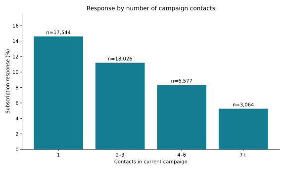

# Bank Campaign Response Analysis

A Python analysis of subscription responses across marketing channels, months, previous campaign outcomes and contact-frequency groups.

## Features

- Validates required fields, binary responses and positive integer contact counts.
- Calculates record counts, subscriptions and response rates for each segment.
- Retains `unknown` categories so totals reconcile to the full input.
- Exports a segment table, JSON summary and contact-frequency chart.
- Includes synthetic unit tests and independently checked aggregate results.

## Results

The supplied dataset contains **45,211 records** and **5,289 positive responses**, an overall response rate of **11.70%**.

| Contacts in current campaign | Records | Positive responses | Response rate |
| --- | ---: | ---: | ---: |
| 1 | 17,544 | 2,561 | 14.60% |
| 2–3 | 18,026 | 2,019 | 11.20% |
| 4–6 | 6,577 | 548 | 8.33% |
| 7+ | 3,064 | 161 | 5.25% |



These are descriptive associations. Contact intensity and channel selection are not randomized, so the rates do not establish the effect of making additional calls. Months are pooled categories, not a chronological time series. Records are counted as rows, not verified unique customers.

## Run

Requires Python 3.10 or later.

```bash
python -m pip install -r requirements.txt
python analyze.py data/banking.csv --output results
python -m unittest -v test_analysis
```

Supply a semicolon-delimited CSV with `contact`, `month`, `poutcome`, `campaign` and `y`. The response field uses `yes` and `no`. Missing required values are rejected. The literal `unknown` is retained as a category. Customer-level input is not included; tests generate their own synthetic records.

Response rate is `positive responses / records` within each segment. Contact groups are 1, 2–3, 4–6 and 7+. Every dimension independently covers the full dataset; do not sum counts across dimensions.

## Outputs

- [Segment summary](results/segment_summary.csv): counts and response rates across four dimensions.
- [Overall summary](results/summary.json): total responses and unknown-category counts.
- [Verification](results/verification.txt): test and reconciliation results.

The implementation uses pandas for grouping, NumPy for numeric validation and Matplotlib for visualization. It uses campaign metadata only and does not produce individual predictions.
